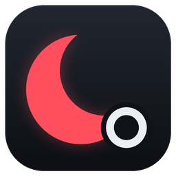
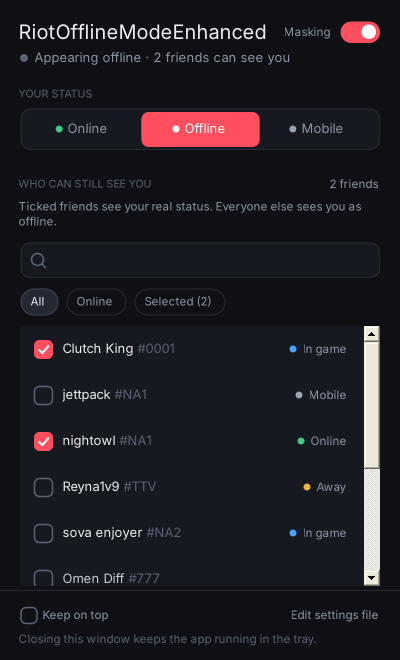

<p align="center">
  
</p>

<h1 align="center">RiotOfflineModeEnhanced</h1>

<p align="center">
  <b>Go dark in Riot chat, and pick who still sees you.</b><br>
  For VALORANT, League of Legends, TFT and the rest of the Riot Client.
</p>

<p align="center">
  <a href="../../releases/latest"><b>⬇ Download the latest release</b></a>
  &nbsp;·&nbsp;
  <a href="#quick-start">Quick start</a>
  &nbsp;·&nbsp;
  <a href="#is-it-safe">Is it safe?</a>
  &nbsp;·&nbsp;
  <a href="#faq">FAQ</a>
</p>

---

Most "appear offline" tools are all-or-nothing: either everybody sees you or nobody does. RiotOfflineModeEnhanced lets you queue in peace while your duo partner, your team or your partner still sees you online, and you control all of it from a small window instead of digging through menus.

<p align="center"></p>

## Features

| | |
|---|---|
| 🌙 **Three modes** | Online, Offline or Mobile, switchable at any time, even mid-match. |
| ✅ **Who-can-see-me list** | Tick friends in the window. They see your real status, and everyone else sees you offline or on mobile. Changes apply instantly. |
| 🟢 **Live friends list** | Search your friends and see who's online, in game, away or on mobile at a glance. |
| 🪟 **A real window** | Dark, compact and resizable. Open it from the tray when you need it and close it when you don't. |
| 💬 **Chat commands** | Message the helper friend `offline`, `online`, `mobile`, `status`, `visible` or `help` without leaving the client. |
| ⚙️ **Settings file** | `RiotOfflineModeEnhanced-settings.json` sits next to the exe. Edit it and save, and changes apply live. |

## Quick start

1. **Download** `RiotOfflineModeEnhanced.zip` from [Releases](../../releases/latest) and extract it, for example to your Desktop.
2. **Close** the Riot Client if it's running.
3. **Run** `RiotOfflineModeEnhanced.exe` and choose your game. It launches the Riot Client for you.
4. **Click the moon** in your system tray to open the window, then pick your mode and tick the friends who may still see you.

> Always start your games through `RiotOfflineModeEnhanced.exe`. Starting the Riot Client normally skips it.

Keep `RiotOfflineModeEnhanced.exe` and `RiotOfflineModeEnhanced.exe.config` in the same folder. To stop the app, right-click the tray icon and choose **Quit**. Closing the window just tucks it away.

## Is it safe?

**What it touches:** only your *chat presence*, the little status your friends see. It runs as a small local relay between the Riot Client and Riot's chat servers and rewrites that one thing. It doesn't modify game files, inject into games, read game memory, or install drivers or services.

**Where the exe comes from:** nobody uploads it by hand. Every release is compiled by [GitHub Actions](.github/workflows/build.yml) on a clean GitHub-hosted Windows machine, straight from the code in this repository. Each release page lists SHA-256 checksums and comes with a signed build attestation.

**Check a download yourself:**

```powershell
# The hash should match the one on the release page
Get-FileHash .\RiotOfflineModeEnhanced.zip -Algorithm SHA256
```

```bash
# Confirms the zip was built by this repo's workflow (needs the GitHub CLI)
gh attestation verify RiotOfflineModeEnhanced.zip --repo declare77/RiotOfflineModeEnhanced
```

**The warning screen:** the app isn't code-signed, so Windows SmartScreen shows "Windows protected your PC" the first time. Choose **More info → Run anyway**.

## FAQ

<details>
<summary><b>Can I get banned for this?</b></summary>

It only changes chat presence. It never touches the game or Vanguard's territory. Deceive, which this project is built on, has been used this way for years, and its README notes that Riot said its users won't be banned. That statement was about Deceive rather than this project, and Riot can change its mind at any time, so use it at your own risk.
</details>

<details>
<summary><b>Will friends on my list be able to invite me?</b></summary>

They see your real status, so for them you look normally online. Friends who see you as offline may not be able to invite you. You can always invite them.
</details>

<details>
<summary><b>Lobby and agent-select chat still work?</b></summary>

Yes. Only your status on friends lists changes. Party, lobby and in-game chat work as usual.
</details>

<details>
<summary><b>"Failing to resolve some required domains"</b></summary>

The app relies on a domain that points back to your own PC, and some networks or DNS providers block that. Switching your DNS to 1.1.1.1 or 8.8.8.8 usually fixes it. The full walkthrough is in the [Deceive FAQ](https://github.com/molenzwiebel/Deceive#faq), because the cause is identical.
</details>

<details>
<summary><b>My antivirus complains.</b></summary>

Apps that relay local network traffic sometimes trip antivirus heuristics. The full source is here, the release is built from it by GitHub, and you can verify the download as shown above.
</details>

<details>
<summary><b>Where are my settings stored?</b></summary>

Your friend picks and display options live in `RiotOfflineModeEnhanced-settings.json` next to the exe. A few small files, such as your last status, the local certificate and a debug log, are kept in `%APPDATA%\Deceive`.
</details>

## Building it yourself

```
dotnet build Deceive/Deceive.csproj -c Release
```

The output lands in `Deceive/bin/Release/net472/`. You can also open `Deceive.sln` in Visual Studio 2022. The app name is the `AppName` property in `Deceive/Deceive.csproj`, so `-p:AppName=Something` builds it under another name. The icon is drawn by [`docs/make_icon.py`](docs/make_icon.py).

## Credits

RiotOfflineModeEnhanced started as a fork of **[Deceive](https://github.com/molenzwiebel/Deceive)** by molenzwiebel and contributors, which does the heavy lifting of relaying Riot chat. The window, the friend picker, live settings and the release pipeline were added here. [MODIFICATIONS.md](MODIFICATIONS.md) lists every change. Please report problems with this project here rather than to Deceive.

Licensed under the **GNU GPL v3.0**, the same as Deceive. See [LICENSE](LICENSE).

<sub>Not affiliated with, endorsed by, or sponsored by Riot Games. Riot Games, VALORANT, League of Legends and Teamfight Tactics are trademarks of Riot Games, Inc.</sub>
